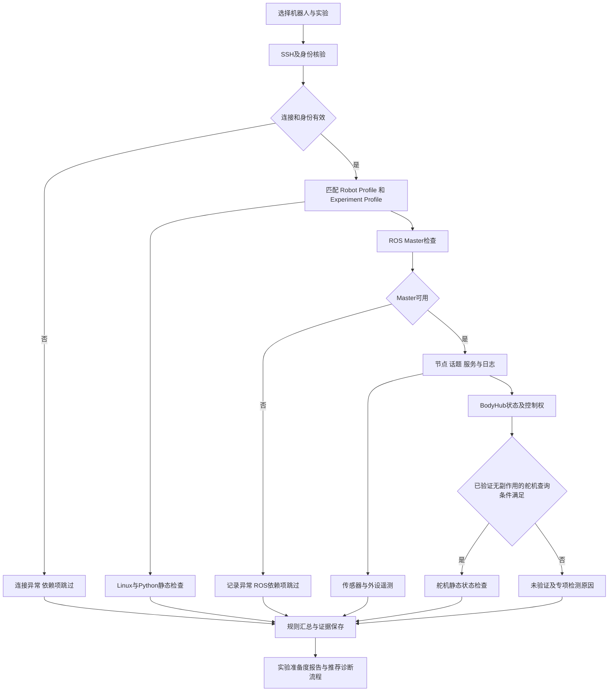
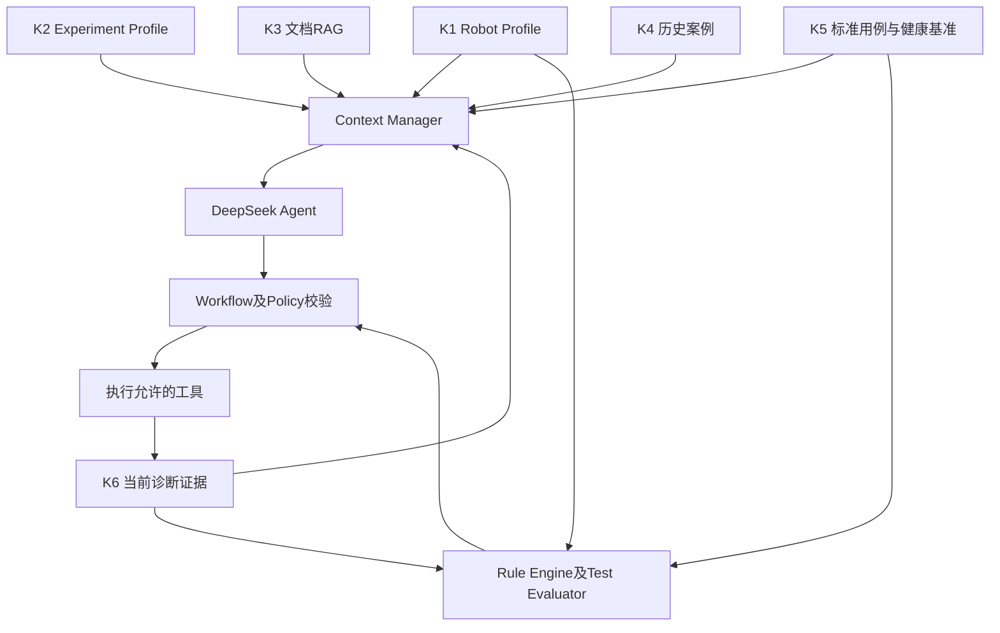
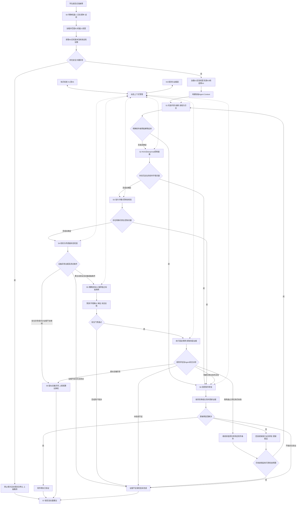
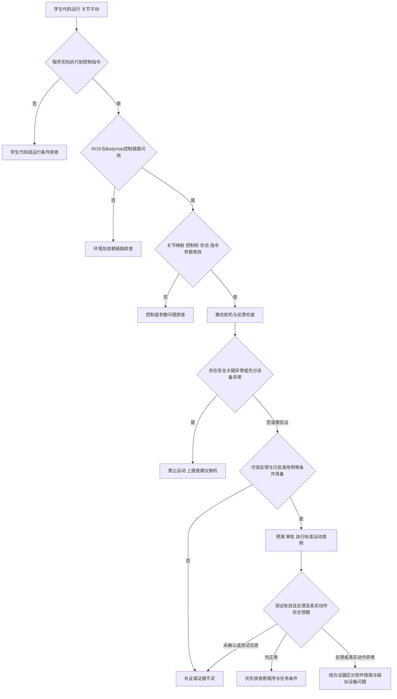

# RobanLab Doctor：一键自检、知识库与软硬件联合诊断最终设计

- 文档版本：v2.1 专项设计（拟实施基线）
- 日期：2026-11-26
- 适用范围：S1～S10 核心自检与联合诊断模块，重点细化 S2、S3、S4、S5、S6 及其与 S7～S10 的协作。
- 上位文档：《RobanLab Doctor 产品设计技术方案与研发计划 v2 精简版》；配套参考：模块化方案 v1.0 的 01～10 号文档。
- 状态说明：本文统一此前讨论的设计口径，不代表功能已全部实现或接口已经实机验收；不改变原有产品分块及 S1～S14 编号，不覆盖原始 Word 文档。

## 0. 设计结论与适用场景

面向在 Roban 机器人本机运行 Python/ROS 实验代码的课程学生。平台运行在学生电脑的 Web 页面，通过 SSH 与机器人端轻量适配器通信，利用 DeepSeek、确定性诊断流程、结构化规则和本地课程知识，实现实验前检查、实验失败后的软硬件故障分流以及受控软件修复。

**一键自检不只是软件检查，但也不是完整硬件功能检测。** 它检测无副作用可获取的软件状态与设备遥测；关节真实运动能力、机械零位、保持能力等由经批准的独立标准测试与外部观察验证。疑似设备异常以报告、联系教师和建议换机为主要处置，不以维修电机或自动标定为目标。

| 产品能力 | 核心问题 | 执行方式 |
| --- | --- | --- |
| 一键自检 Quick Check | 当前机器人和实验环境是否存在明显异常？ | 确定性 R0 无副作用检查；无须 LLM |
| 智能诊断 AI Diagnosis | 实验为什么失败？ | 固定主干 + 专项流程 + Agent + 规则 + 知识 |
| 专项功能测试 Functional Test | 脱离学生程序后，设备能否完成预期功能？ | 固定用例、预演、现场确认及本机执行 |
| 修复与复测 Repair & Verify | 已定位的软件问题是否真正解决？ | 差异审查、受控修复、分级复测与回滚 |

本文的三部分分别回答：检测什么、Agent 需要知道什么、如何将知识和检测证据转化为下一步决策。

---

# 第一部分　一键自检设计（S2）

## 1.1 功能边界

一键自检定义为静态、非侵入式的实验前检查。可以短时采样已有遥测和消息更新情况，但不主动改变被检对象状态，不自动获取控制权、不重启节点、不修改文件、不切换 BodyHub 状态、不改变舵机力矩、不下发动作、不抢占串口或相机，也不执行任意学生脚本。查询名称含 `Get` 不构成 R0 证明。

静态自检通过只表示**已执行且具备有效证据的检查项通过**，不等于整机健康或运动安全。对没有接口、未获验证、当前工况不允许读取的项目，明确记录未验证原因，不用软件缓存替代真实反馈。

设计依据：v2 §2.3.1、§3.5；v1.0 模块 03、06、07；早期实机资料 §3.3、§4.2。v2 §1.2 记载单机原型曾跑通只读自检、规则归因与一次白名单修复；这不是本次实时检查结果，也不证明下表所有能力已实现。

## 1.2 检测范围与实现清单

下表中的 P0/P1/P2 是本专项内的实现优先级，沿用总体方案核心优先原则，并非重新定义 S1～S14。P0 中涉及设备接口的项目仍以 M0 实机核验通过为先决条件。

### A. SSH、设备身份和 Linux 基础环境

| 检测 ID | 检测内容 | 数据来源/实现 | 判定与后续决策 | 优先级 |
| --- | --- | --- | --- | --- |
| NET-01 | TCP/SSH 连通 | Paramiko 连接与握手 | 不通：区分超时、拒绝、认证失败；依赖项跳过，不能推断硬件损坏 | P0 |
| NET-02 | 机器人身份 | SSH 主机密钥、已验证设备标识、会话指纹 | 身份不符：停止涉及设备的执行和旧审批复用 | P0 |
| NET-03 | 远程命令能力 | 白名单无副作用探测 | 权限或 Shell 异常：转网络/环境诊断 | P0 |
| SYS-01 | OS、架构及 Python/ROS 环境基线 | 系统版本文件、`uname`、解释器及 ROS 版本 | 版本不符：重新选择 Profile；未知版本限制接口调用 | P0 |
| SYS-02 | CPU、内存、磁盘、inode | `/proc`、`free`、`df` | 资源不足或持续异常：环境诊断；阈值按实验需求配置 | P0 |
| SYS-03 | 时间与日志时间戳 | 机器人时间、后端接收时间 | 时间差或数据过期：限制跨设备时序比较 | P1 |
| SYS-04 | USB/串口/音频设备枚举 | `lsusb`、设备节点、已有内核日志 | 设备未识别/反复断连：通信链路异常候选，不能直接确诊设备损坏 | P0/P1 |
| SYS-05 | 目录与权限 | `stat`、`test`、白名单目录检查 | 文件不可读/不可写：环境或权限问题；不自动提权 | P0 |

### B. Python 与课程实验环境

| 检测 ID | 检测内容 | 数据来源/实现 | 判定与后续决策 | 优先级 |
| --- | --- | --- | --- | --- |
| PY-01 | 解释器与 ROS Python 匹配 | 实际运行命令、解释器版本、ROS 环境 | 版本或环境配置错误：进入软件诊断 | P0 |
| PY-02 | 实验目录、入口与资源 | Profile、路径、文件元数据 | 入口/模型缺失：记录具体缺失项 | P0 |
| PY-03 | Python 语法 | 使用目标解释器静态解析/内存编译 | 语法失败：定位文件与行号，不执行顶层代码 | P0 |
| PY-04 | 依赖与 ROS 包可发现性 | 安装信息、受控模块定位、包路径 | 缺失或未知：专项检查；避免任意 import 引发动作 | P0 |
| PY-05 | 配置结构及可信基准 | YAML 等静态解析、已批准哈希或版本 | 缺失/损坏/不匹配：转配置诊断 | P0 |
| PY-06 | 已有运行日志与进程 | 白名单日志、进程状态 | 异常栈、提前退出、等待阻塞候选；不自动运行实验脚本 | P0/P1 |

静态检查无法证明复杂算法、视觉识别、轨迹规划及真实执行正确。对于尚未选择脚本的通用自检，将脚本专属项目标记为不适用或等待选择，不报故障。

### C. ROS 通信层

| 检测 ID | 检测内容 | 数据来源/实现 | 判定与后续决策 | 优先级 |
| --- | --- | --- | --- | --- |
| ROS-01 | ROS Master 可达 | Master API | 不可达：控制环境异常，跳过依赖检测 | P0 |
| ROS-02 | 必需节点注册及响应 | `rosnode list`、`rosnode ping` | 节点缺失或不响应：结合启动阶段与日志分析 | P0 |
| ROS-03 | 话题存在、类型、发布/订阅关系 | `rostopic list/info/type` | 必需链路不完整或类型不匹配 | P0 |
| ROS-04 | 消息有效更新 | 有时限订阅、已有时间戳、采样计数 | 持续发布型话题无新消息：异常；按需话题需结合工况 | P0/P1 |
| ROS-05 | 服务注册、类型及响应 | `rosservice list/info/type`；仅调用已验证 R0 服务 | 注册不等于可用；未知副作用的服务不调用 | P0 |
| ROS-06 | ROS 参数及错误日志 | 白名单参数、`/rosout`、指定日志 | 配置异常、节点错误或依赖失败；不自行重启 | P0 |

### D. BodyHub 控制层

| 检测 ID | 检测内容 | 数据来源/实现 | 判定与后续决策 | 优先级 |
| --- | --- | --- | --- | --- |
| BH-01 | 节点、接口和版本指纹 | ROS graph、运行程序及已确认源码/配置 | 版本匹配才使用对应状态枚举和接口策略 | P0 |
| BH-02 | 状态机、队列信息 | `GetStatus`（核实后） | 状态是否适合当前实验；running/walking 不自动判故障 | P0 |
| BH-03 | 控制权 | `GetMasterID`（核实后） | 被占用：实验暂不具备控制条件；不能擅自抢占 | P0 |
| BH-04 | 关节缓存完整性 | `GetJointAngle`（核实后） | 缺失、无效值或异常变化；数据源标记 cache | P0 |
| BH-05 | 拒绝、保护、通信错误 | 当前版本的 BodyHub 日志、状态 | 只按已知语义判定，不能假设超限必然自动锁死 | P0/P1 |
| BH-06 | 关节映射、限位和零偏文件 | 已确认的运行配置与加载证据 | 缺失/冲突/版本不符：阻断相关动作；文件正常不证明机械零位正确 | P1 |

### E. 全 22 舵机静态状态（硬件遥测）

| 检测 ID | 检测内容 | 可证明的事实 | 限制与处理 | 优先级 |
| --- | --- | --- | --- | --- |
| SV-01 | ID 1～22 通信响应及数量 | 指定 ID 是否返回可信通信结果 | 扫描须无状态变化且不干扰总线；超时先排除公共链路 | P0 条件项 |
| SV-02 | 温度 | 舵机报告的温度状态 | `PresentTemperature` 经核验后使用；阈值来自厂商或批准基准，不直接采用历史脚本默认值 | P0 条件项 |
| SV-03 | 力矩使能状态 | 舵机报告的使能/锁定标志 | `GetServoLockStateAll` 经核验后使用；力矩开启不等于实际输出足够 | P0 条件项 |
| SV-04 | 实际编码器位置 | 电机侧位置读数 | `GetServoPositionAll` 可能改变状态；仅在确认 R0 的工况下进入静态自检 | P1 条件项 |
| SV-05 | 反馈质量与缓存差异 | 数据缺失、异常跳变或时间/坐标对齐后的差异 | `ServoPositions` 来源待核验；差异不能直接证明硬件损坏 | P1 |
| SV-06 | 电压、电流、负载、硬件错误码 | 对应设备侧遥测或保护信息 | 当前资料未确认可用接口，不作为必交静态检查 | P2 探索 |

不能通过静态检查独立证明：正反向运动能力、位置保持/带载能力、实际机械输出力矩、机械卡滞或传动松动、机械零位准确性。对应验证由标准运动测试和外部观察承担。

### F. 视觉、IMU、压力、音频及电源

| 设备 | 自检能力（需接口及工况支持） | 专项测试/人工验证 | 优先级 |
| --- | --- | --- | --- |
| 头部深度相机 | USB 识别、节点、彩色/深度话题、新帧、格式 | 已知目标识别、深度/标定准确性 | P0 基础/P1 深入 |
| 下巴相机 | 设备识别、节点、图像消息更新 | 图像质量、视角、实际识别效果 | P0 基础/P1 深入 |
| IMU | 话题、更新率、有限值、已知工况合理性 | 经批准的参考姿态和响应验证 | P0 基础/P1 深入 |
| 脚底压力 | 通道完整性、更新、数值有效性 | 已知受力工况下的响应；悬空不能按站立基准判断 | P1 |
| 麦克风/扬声器 | 设备枚举、已有音频服务或数据状态 | 经同意的录音/播放及现场观察 | P1 |
| 电池/电源 | 已有且经核验的电源遥测 | 带载能力等需专门条件 | P1/P2 |

默认只观察已有节点数据，不抢占设备。某功能按实验设计尚未启动时，应标记待启动/不适用，而不是传感器故障。

## 1.3 BodyHub 接口能力与副作用清单

已知事实来自本地 `bodyhub_new` 源码整理，不等同于当前设备版本：20 个身体舵机 + 2 个头部舵机；`GetJointAngle` 返回 `ServoStore.angle` 缓存，命令处理也可能更新缓存；`GetServoPositionAll` 非仿真分支读取 `Present_Position`，且 `ready` 时可能切换至 `directOperate`。

| 接口（省略公共前缀 `/MediumSize/BodyHub/`） | 候选用途 | 默认处理 |
| --- | --- | --- |
| `GetStatus`、`GetMasterID` | 状态与控制权 | 核验无副作用后登记 R0 |
| `GetJointAngle` | 软件缓存角度 | 核验后 R0；标记 cache |
| `ServoPositions`、`Status` | 已发布遥测 | 先核验消息类型及数据来源 |
| `DirectMethod/GetServoPositionAll` | 舵机位置读数 | 状态影响型候选；未知/会切换状态则排除 R0，进入专项审批 |
| `DirectMethod/GetServoLockStateAll`、`PresentTemperature` | 力矩状态及温度 | 核验实现、总线影响及安全工况后决定 |
| `StateJump` | 状态切换 | 非 R0；按后果分级，可能涉及 R3 |
| `DirectMethod/SetServoLockState` / `SetServoLockStateAll` | 力矩设置 | R3，禁止一键自检 |
| `jointControl`、`MotoPosition`、`HeadPosition`、位置设置服务 | 动作执行候选 | R3，必须使用已批准执行器 |

接口注册表按版本、状态、前置条件维护：`read_only_verified`、`state_affecting`、`motion_affecting`、`unknown`。接口未知时默认拒绝调用，而不是尝试后再判断是否危险。历史 `healthy_checker.py` 和厂家 `check` 只能在逐个核实其动作及串口行为后复用，不直接整段执行。

现有资料中旧版状态枚举与课程课件的示例状态值不同；右臂 14 号历史反馈与旧软件范围存在差异。不得把课件状态字典或旧角度数组作为未经实机匹配的硬性诊断、安全限位或运动依据。

## 1.4 Experiment Profile：检查适用性

一键自检支持通用基础检查 + 所选实验专项预检。Profile 标明必需/可选/不适用项目，区分实验启动前、运行中和运行后工况。

| 实验类型 | 必需检查重点 | 按需补充 |
| --- | --- | --- |
| 关节控制/动作编排 | ROS、BodyHub、控制权、相关舵机、动作库及脚本 | 参考姿态及相关固定运动用例 |
| 视觉伺服 | 相机、新帧、OpenCV、必要模型、ROS 及运动链路 | 已知图像/目标测试、相关关节用例 |
| 语音交互 | 音频设备、服务、模型、Python 依赖 | 实际录音、播放与识别测试 |
| IMU/压力实验 | 驱动、话题、数据有效性及工况 | 参考姿态、受力响应 |
| CoppeliaSim 仿真 | 仿真环境、场景、接口、仿真节点 | 模拟轨迹；不要求真实舵机反馈 |

未选择实验时允许通用自检；实验相关必需条件未知时不宣称该实验可正常运行。仿真结果与真实机器人证据严格区分。

## 1.5 自检调度与输出

采用依赖关系 DAG 而非让 Agent 自由选择自检顺序；同一共享设备、串口和 BodyHub 查询按资源锁串行，其他无副作用检查可并行。执行设置超时、有限重试、任务取消、原始输出大小与日志脱敏限制。



### 检测状态与实验准备度

| 状态 | 语义 |
| --- | --- |
| PASS | 取得有效证据且满足当前检查条件 |
| WARN | 观察到非阻塞警告或需要关注的条件 |
| FAIL | 有明确证据证明检查条件不满足；不等于根因已确诊 |
| UNKNOWN | 读取失败、证据不足/冲突/过期、版本或能力未知 |
| SKIPPED | 因依赖、安全条件、取消等原因未执行 |
| NOT_APPLICABLE | 当前实验/工况不要求该项 |

每项另设 `severity`（info/warning/blocking/safety_critical）、`required_for_experiment`、`reason_code`、`evidence_ids`。未实现能力采用 UNKNOWN 或 SKIPPED 并记录 `unsupported`/`unverified_interface`，不要增加含糊的正常值。

汇总建议采用：`BLOCKED`（有阻塞或安全异常）、`INCOMPLETE`（必需检查未知/跳过）、`READY_WITH_WARNINGS`（必需检查通过且仅有非阻塞警告）、`CHECKS_PASSED`（必需检查通过）。按上述顺序优先匹配；未选实验仅报告通用检查覆盖。`CHECKS_PASSED` 不是实机运动审批。报告展示通过/警告/异常/未知/跳过/不适用数量及缺失证据，不用单一健康百分比分数掩盖未检测项目。

### 检测项定义（示例，不是实机配置）

```yaml
id: BH-02
name: BodyHub状态查询
risk_level: R0
required_capability: bodyhub.get_status.read_only_verified
depends_on: [NET-01, NET-02, ROS-01, BH-01]
collector: get_bodyhub_status
resource_lock: bodyhub
rules_ref: profile.bodyhub.state_semantics
next_workflow: ros_environment
motion_required: false
```

```json
{
  "check_id": "BH-02",
  "robot_id": "example_robot",
  "status": "UNKNOWN",
  "severity": "blocking",
  "reason_code": "INTERFACE_VERSION_UNVERIFIED",
  "required_for_experiment": true,
  "observed": null,
  "evidence_ids": [],
  "next_workflow": "ros_environment",
  "motion_verified": false
}
```

自检报告保存机器人指纹、配置版本、实验 ID、时间、检查覆盖及推荐专项流程。Agent 从现有自检快照读取有效证据，动态数据过期或设备切换时重新检查。

---

# 第二部分　知识库与 Agent 上下文设计（S3/S4/S6）

## 2.1 统一知识分类：六类诊断信息，不是六个独立数据库

v1.0 模块 04 和 v2 §3.4 按存储性质区分结构化设备事实、文档、历史案例和实时证据。本文保留该基础，进一步区分课程 Profile 和标准测试基准，并统一使用以下 K1～K6 作为 **Agent 的信息来源分类**，替代此前讨论中不够严格的 K1～K5 分类。K5 与 K6 由运动测试系统及观测层管理，不归入 RAG 文档索引。

| 编号 | 信息类别 | 内容 | 管理归属/获取方式 | 加载时机 |
| --- | --- | --- | --- | --- |
| K1 | 结构化机器人知识 | 软硬件架构、22 电机、接口、状态机、关节轴、单位、限制及副作用 | Robot Profile；按设备版本精确读取 | 初始必载；版本变化更新 |
| K2 | 结构化课程实验知识 | 实验目标、入口、运行阶段、依赖、必需节点、正常现象、关联测试 | Experiment Profile；精确读取 | 确定实验后加载；切换时更新 |
| K3 | 非结构化领域知识 | 厂家文档、课件、源码、说明与参考程序 | 本地文档 RAG；关键词/语义检索 | 初始相关检索；阶段/异常/按需触发 |
| K4 | 历史故障案例 | 症状、证据、原因、修复、失败尝试、复测与版本 | Fault Case Base；结构化查询及文本检索 | 类似故障时 |
| K5 | 标准测试与健康基准 | 固定轨迹、适用关节、安全工况、参考姿态、实机误差及验收规则 | Motion Test Registry / Baseline Store；精确 ID、版本、工况查询 | 推荐、准备及评估测试时 |
| K6 | 当前诊断证据 | 当前设备信息、命令、日志、ROS、缓存、编码器、现场观察 | Observer / Diagnostic Data Layer；实时采集和证据引用 | 初始化与持续按需刷新 |

K1、K2 属于结构化知识；K3、K4 适合检索增强生成；K5 属于测试定义及数值参考资产；K6 是真实观测和任务事实，不是 RAG 历史文档。Skill 与 Workflow 不作为上述知识库类别：前者沉淀排查方法，后者强制控制流程。

## 2.2 Robot Profile：让 Agent 在开始时了解机器人

Profile 应以实机版本匹配的结构化设备档案为基础，至少登记：机器人型号与硬件组成、软件版本、控制链路、关节编号/名称/轴向/符号/单位、ROS topic/service/type、状态机语义和控制权机制、反馈数据来源、已验证安全限制、配置与日志路径、支持的遥测及已知接口副作用、适用测试版本、来源和审批状态。

以下仅为结构示例，`pending` 字段必须人工核验，不可作为运动依据：

```yaml
profile_id: roban_unverified
review_status: needs_robot_version_match
robot_model: Roban
expected_servo_count: 22
software_baseline:
  os: Ubuntu 16.04
  ros: Kinetic
  python: ['2.7', '3.5']
control_component: BodyHub
joint_groups_from_backup:
  right_arm: [13, 14, 15]
  left_arm: [16, 17, 18]
  grippers: [19, 20]
  head: [21, 22]
state_mapping_ref: pending
joint_mapping_version: pending
verified_limits_ref: pending
stop_policy_ref: pending
interfaces:
  GetJointAngle:
    data_source: software_cache
    side_effect_class: unknown
  GetServoPositionAll:
    data_source: servo_position_feedback
    side_effect_class: state_affecting
    note: backup_ready_to_directOperate
capabilities:
  motor_current: unknown
  motor_voltage: unknown
  hardware_fault_code: unknown
  continuous_position_feedback: unknown
```

连接机器人后读取实际运行版本与能力，再与 Profile 匹配。历史 Ubuntu 16.04、ROS Kinetic、Python 2.7/3.5 是资料基线，不可替代当前实机识别。版本未知时允许无副作用的基础取证，不开放依赖未知状态机、关节映射或限位的动作。Agent 不可自行修改安全关键 Profile。

## 2.3 Experiment Profile：让 Agent 知道学生正在做什么

配置实验名称、适用设备、脚本和允许执行命令、必要依赖、预期节点/话题/服务及启动时机、正常现象、评价条件、专项流程、相关知识范围及可用测试。实验未选定时先按通用自检处理，并由用户或 Agent 补充确认。

```yaml
experiment_id: vision_servo
name: 视觉伺服实验
mode: hardware_or_simulation_to_be_selected
required_components: [ros_master, camera, opencv, bodyhub]
required_topics_ref: pending
entrypoint_ref: pending
expected_behavior_ref: pending
workflows: [python_runtime, vision_no_frame, vision_algorithm, joint_no_motion]
knowledge_scopes: [course/vision_servo, robot/camera, robot/bodyhub]
related_test_ids_ref: pending
```

示例不表示所有视觉实验必需同一套节点和话题；具体课程脚本应逐个核验。对应 v1.0 模块 02、04、07，v2 §2.3.1 和 §2.3.3。

## 2.4 文档知识库与 RAG 实现

### 数据来源与索引范围

| 来源 | 主要用途 | 导入注意事项 |
| --- | --- | --- |
| `roban_backup/src/bodyhub_new`、`bodyhub` | 状态机、控制权、接口与副作用 | 两版本独立索引，核对实机匹配 |
| `leju_lib_pkg` | 轨迹发送、角度处理、软件范围 | 旧限制不直接作为机械安全限位 |
| `leju_test_nodes/scripts/healthy_checker.py` | 舵机与外设检查 | 核对是否侵入式、是否改变力矩或状态 |
| `ros_dance_node`、`pen_writer` | 动作帧、关节映射、运动学及实验案例 | 保留代码版本及验证范围 |
| BodyHub launch 与 `offset.yaml` 等 | 零偏配置、加载路径和坐标关系 | 区分包内文件、用户配置及实际加载情况 |
| 课程课件、实验记录、参考代码 | 正常实验流程、依赖、历史故障 | 保留实验时间、实机/仿真区别 |
| 厂家手册及标定说明（若拥有） | 故障码、厂家操作规程及物理基准 | 必须核对版本和真实性 |

这些路径来自原始资料及 v1.0 文档；本文未扫描用户本机完整源码仓库或实际建立索引。

### 索引流程与技术选型

1. 来源登记：文件路径、哈希、版本、日期、文档类型、机器人型号、所属组件、审查状态；禁止索引 SSH 密码、私钥、API Key 等凭据。
2. 解析分块：Markdown 按章节，PDF/Word 按标题与页码/段落，源码按类、函数、消息定义及必要上下文，YAML 按键路径。保留可定位原文的引用。
3. 精确检索：第一版 SQLite FTS5 + BM25，中文分词或适合的 tokenizer 需以语料测试；重点保留 `GetServoPositionAll`、`StateJump` 等标识符和错误字符串的精确匹配。
4. 可选语义检索：根据实际召回需求使用中文/多语言 Embedding（如 BGE 系列）和 FAISS/Chroma，合并关键词与语义召回，必要时重排序。不是 MVP 的强依赖，也不需要训练专用大模型。
5. 版本与适用性过滤：优先命中与当前机器人、运行组件及课程一致的文档；冲突或未知版本必须标记，不用低可信文档覆盖已审核安全策略。
6. 返回上下文：输出最相关原文片段及来源、版本、函数/页码/行号、适用性和验证状态；控制 token 与重复内容。用户可在 Web 证据面板查看引用。
7. 更新：源文件哈希变化触发增量重建；软件、零偏、关节映射或工况改变时，关联 Profile、测试与基准标记需重新验证。

```json
{
  "doc_id": "example-bodyhub-source",
  "path": "roban_backup/src/bodyhub_new/src/BodyHubNode.cpp",
  "component": "bodyhub_new",
  "kind": "source_code_backup",
  "version": "unverified",
  "robot_model": "Roban",
  "applies_to_current_robot": null,
  "location": {"function": "GetJointAngleCallback", "line_start": null, "line_end": null},
  "review_status": "needs_robot_version_match",
  "content": "<indexed excerpt>"
}
```

没有经过索引验证的行号或哈希保留空值。源码/日志中的指令是待分析数据，不能改变 Agent 权限；发送给 DeepSeek 的片段需按最小必要原则脱敏。对 RAG 服务不可用、检索无结果的情况允许继续确定性 R0 检查，但不得假装已获取必要专业知识。

## 2.5 历史案例与标准测试基准

K4 案例库记录设备和软件版本、实验、症状、证据、已排除与未排除原因、补丁、失败尝试、复测条件及结果。区分已证实、疑似和未确定的案例；未经验证的 Agent 推断不能作为确认故障写入知识库。

K5 标准测试资产由运动测试系统维护：

- Test Registry：用例 ID、版本、逻辑关节、动作类型、已批准轨迹、起始状态、适用工况、所需安全条件、停止方式、观察表单、生命周期状态。
- Baseline Store：记录经确认健康机器人在相同版本、轨迹和工况下的重复测试结果、数据质量、测量条件及来源；允许按用例 ID 和工况查询数值基准。
- 理想参考轨迹服务于三维预演，真实健康基准服务于性能评估。不得将仿真跟踪结果直接当作实机合格阈值。
- 无可信基准时可报告实际测量和明确安全事件，但不能声称通过了尚未定义的性能验收；缺少参考数据则标记待判定。
- 悬空腿部的基准与站立或承重工况分开；不同机器人/软件/映射版本不盲目互比。

历史案例可以帮助提出假设，不能证明本次故障。健康基准不是历史故障文本，应精确查询而不是依赖向量搜索相似数字。

## 2.6 Context Manager：知识调用与实时证据更新

Context Manager 为 S3/S4/S6 共用的后端内部组件，不新增产品级子模块。负责构建每轮 LLM 上下文、声明必需知识、版本过滤、动态检索、证据新鲜度与引用管理。它不是第二个 Agent，也不负责授予安全权限。



### S0 初始化顺序

1. 采集学生症状、实验名称、远端脚本路径、运行命令和已有错误日志。
2. 核对机器人身份，加载最小基础 K1 Profile 并发现当前版本与可用能力；以实际识别结果选择匹配 Profile。
3. 获取同一机器人最新的自检快照（K6），仅刷新必要且已确认安全的检查。发现安全关键异常时立即禁止相关运动，不等待 RAG。
4. 确认所选实验并加载 K2，形成相关专项诊断子流程和所需检查项。
5. 根据症状、设备版本、实验及初始证据检索 K3，适用时检索 K4；不预先将全部文档发送给模型。
6. 构建初始 Agent Context，并将未知事实与版本冲突显式记录。

### 阶段知识需求与检索时机

| 诊断阶段 | 强制加载或精确查询 | 按需检索（K3/K4） | K6 证据刷新 |
| --- | --- | --- | --- |
| S0 上下文 | K1/K2、初始自检快照 | 相关课程、控制架构、类似症状 | 设备身份、版本、必要静态状态 |
| S1 代码与环境 | K2 入口、解释器、依赖 | 参考代码、安装/运行说明、错误案例 | 源码、日志、进程、环境 |
| S2 ROS/BodyHub | K1 接口、状态机、控制语义 | 对应版本源码与控制文档 | Master、节点、话题、服务、状态 |
| S3 指令与参数 | K1 映射、单位、已验证限位；K2 任务要求 | 消息构造、超限行为、控制权案例 | 命令、参数、控制权、接受证据 |
| S4 设备观测 | K1 接口来源与副作用、能力表 | 健康检查实现、故障说明 | 舵机/传感器遥测及观察 |
| S5 标准测试 | K5 用例、审批条件、基准；K1/K2 适用范围 | 测试说明、零位参考与异常解释 | 起始状态、实际反馈、人工观察 |
| S6 修复/处置 | K1/K2 配置与运行约束、Policy | 已知修复方案、课程正确示例 | diff、备份、复测及安全状态 |
| S7 报告 | 本次引用、证据及结论 | 通常复用已有检索；缺失时补查 | 最终有效证据与未完成原因 |

三种检索触发机制：

- 阶段触发：Workflow 声明必需字段及检索范围；已加载且适用的知识复用，不必每步重复搜索。
- 异常触发：检测项出现新错误码、版本冲突或不一致证据时，根据异常上下文检索当前组件的相关说明。
- Agent 按需触发：通过 `search_robot_knowledge(query, component, robot_profile, experiment_id)` 补充专业知识。结果作为候选知识，不直接授予执行权限。

每轮 Context 包括 System Prompt（角色/目标）、Workflow Stage、已验证 Profile 子集、专项 Skill、当前证据及其质量、检索结果及引用、已确认事实、待验证假设、已执行步骤、用户描述与观察、当前允许工具。任务持久化保留这些对象的引用而非重复保存整份文档；可裁剪无关片段，但不能裁剪安全约束或关键未知项。

实际设备变化后重新绑定会话；控制权、温度、状态、反馈等动态数据按有效期刷新。旧机器人或旧执行任务的证据不能直接复用；未知/过期数据不得用于安全准入。

## 2.7 知识可信度与信息架构关系

- 对“当前发生了什么”，优先使用可靠、同设备同工况的新鲜测量，再核对当前配置/运行实现。
- 对“应该怎样操作”，必须采用经审核并与当前设备匹配的安全 Profile、厂家规范与已批准测试；实际读数不能自行改写限位规则。
- 对“原因是什么”，使用匹配版本的文档和历史案例生成候选解释，再用当前证据验证。冲突保留并报告，不由 LLM 任意选取一个版本。
- 规则引擎、测试评估器、Policy 直接读取结构化配置和证据，不经过模型转述。

**四层诊断证据**描述实际数据的来源；**六类诊断信息**描述 Agent 所需的输入；**六个诊断协作层**描述系统如何完成检查与执行。三者是不同维度，不互相替代。

---

# 第三部分　总体诊断逻辑与软硬件联合决策（S3～S10）

## 3.1 架构职责与执行原则

| 协作层（沿用 v2 §3.3） | 职责 |
| --- | --- |
| Workflow | 确定性 S0～S7 主干、条件分支、专项子流程、循环上限、人工暂停与恢复 |
| Rule Engine | 把明确证据映射成检查事实、限制和后续建议，不越过证据推断根因 |
| Skill | Markdown 沉淀专项排查策略与解释原则，不承担强制执行和安全门禁 |
| Tools | 封装参数化 SSH、ROS、静态检查、证据获取、测试准备及受控修复 |
| RAG | 提供版本匹配的文档、源码与历史案例知识 |
| Policy | 对所有有副作用操作校验作用域、条件、审批、风险及设备状态 |

DeepSeek Agent 负责理解自然语言、提出和排序故障假设、选用允许的工具、解释结果；Context Manager 组织输入；Robot Observer 与 Diagnostic Data Layer 提供事实；Motion Test System 执行和评价标准用例。浏览器不直接访问 SSH 或 DeepSeek 密钥。学生手动测试与 Agent 推荐测试走相同安全网关。

## 3.2 诊断主流程（统一版）

以下沿用 S0～S7 阶段编号；阶段编号与产品子模块 S1～S14 不是同一编号体系。流程以固定主干为基础，允许在充分证据下跳过无关阶段，但不能跳过安全门禁。安全异常监控贯穿任务，而不只发生在初始化。



实线是主要流程，虚线是知识与证据的持续交互。图为业务主干，并非要求每个节点一定执行；每个阶段内部由安全网关验证。发现过温、明确保护、异常运动等安全事件立即中断相关测试，不继续诊断性动作。网络不可达/身份不符时停止依赖远端的操作并保存已取得证据；未匹配 Profile 时不得用历史接口进行试探性运动。

## 3.3 阶段退出条件及 Agent 行为

| 阶段 | 核心检查 | 退出与分支条件 |
| --- | --- | --- |
| S0 | 设备、实验、代码、运行命令、症状、现有自检、知识初始化 | 信息足以开始；缺少非关键项可带 unknown 继续；缺少关键身份/安全条件则暂停相关操作 |
| S1 | Python 版本、语法、依赖、进程、traceback、阻塞位置 | 明确软件错误进入 S6；下游设备超时导致的 traceback 转对应专项检查，不用延长超时掩盖设备问题 |
| S2 | ROS Master、节点、服务、话题、消息与 BodyHub | 明确环境异常进入 S6 或教师处理；不能确认可用链路时不能主动运动；其余转 S3 |
| S3 | 控制权、模式、关节 ID、方向、单位、角度、消息、队列及指令接受证据 | 明确参数/控制错误进入 S6；缺少可信限制则阻断动作；否则转 S4 |
| S4 | 舵机通信、温度、力矩状态、缓存/电机反馈及传感器 | 安全关键异常停止；证据足够可直接处置；需要主动验证且具备安全准备条件时转 S5 |
| S5 | 精确查询固定用例、三维预演、环境确认、执行、记录、评估、人工观察 | 通过/异常/无法判定/中止；不得将未执行或未观察视为失败或通过 |
| S6 | 软件修复、复测、回滚或疑似设备换机/上报 | 确认原问题解决；失败时有限次继续排查；无法安全验证或无新证据则退出 |
| S7 | 事实、知识引用、结论、修复历史、测试结果、不确定性及建议 | 输出报告，保留多个并存故障及未验证内容 |

## 3.4 四层证据与统一观测模型

沿用 v2 §3.4、v1.0 模块 03 的四层体系，不使用 K1～K6 替换它。

| 证据层 | 主要内容 | 判断边界 |
| --- | --- | --- |
| 计划与指令层 | 实验代码、测试目标、轨迹、发包时间及接收证据 | 发包成功不等于控制器接受 |
| 软件状态缓存层 | BodyHub 状态、控制 ID、`GetJointAngle`、日志 | 缓存角度不是电机独立测量 |
| 电机编码器反馈层 | 经验证舵机直读角度、力矩使能、温度等 | 编码器变化不等于机械连杆正确运动 |
| 外部物理观察层 | 用户报告方向、幅度、零位、抖动、异响、下垂，或可信外部测量 | 主观观察不等于高精度角度/力矩传感器 |

通用 Linux、Python 和 ROS graph 证据作为环境/控制上下文纳入同一 Evidence Store；四层是运动因果链的语义分离，并不要求所有系统日志都映射成电机证据。

每个证据记录：`evidence_id`、`diagnosis_id`、`robot_id`、`robot_fingerprint`、`execution_id`（若有关）、来源类型/接口、目标关节/组件、值及单位、机器人采样时间、后端接收时间、有效性、新鲜度、坐标/映射版本、接口副作用、原始输出引用。没有控制器接受确认机制时 `command_received=unknown`，不能以 publish 成功填 true。

采集与评估必须检查同设备、同关节、同版本、同一任务、时间可对齐、反馈独立性及数据有效性。轨迹由机器人本机执行器记录计划与反馈，采样率或时钟对齐不足时，只在验证可行的稳定位置/保持区间计算指标；不可强行计算动态 RMSE。人工观察保留原话、时间、观察条件及不确定性。

## 3.5 关节不动的专项决策树



| 典型证据 | 能确认什么 | 下一步 |
| --- | --- | --- |
| Python 语法失败/必需文件不存在 | 明确软件检查异常 | 修复并按权限复测 |
| BodyHub 未注册或不可达 | 控制环境不可用，根因尚未确认 | 查启动日志、依赖、驱动及下游通信；不直接认定电机坏 |
| 控制权被占用 | 当前控制条件不满足 | 查现有实验与状态机；不擅自抢占控制权 |
| 目标超出已核验限制且有拒绝证据 | 参数问题能解释命令失败 | 修复参数；不提高限位、不解除保护以试探 |
| 多个舵机同时无有效通信 | 共享链路异常候选 | 排查串口、总线、供电、驱动；必要时教师处理 |
| 单个舵机持续无响应，ID 与公共链路核对通过 | 局部设备/通信异常可能性升高 | 报告并建议更换；不强行运动 |
| 温度、保护或物理异响异常 | 安全关键风险 | 停止相关动作，联系教师 |
| 力矩未使能 | 使能状态不满足预期 | 核对控制状态、保护及代码；不自动上电 |
| 反馈正常但学生程序仍失败 | 静态反馈不能验证动作 | 若具备条件，推荐独立标准测试 |
| 关键接口未知、数据缺失或过期 | 证据不足 | 补充安全观测，不盲目执行动作 |

注意超限、力矩关闭、节点未启动可由软件状态或设备保护等多因素引起；只有在实际版本和证据支持时才归因。软件问题与设备异常可以同时存在。

## 3.6 S5 独立标准运动测试：软硬件分流的核心证据

### 测试设计

标准用例独立于学生代码，由经过验收的固定轨迹和统一执行器完成。覆盖 22 个电机的规划目标，实际用例数可超过 22，包括单轴往返、保持、肩部前后方向与侧向平举、屈肘、复合/对称动作、参考姿态、腿部悬吊用例。具体轴向、编号、角度范围、轨迹和停止策略须经过映射核验、仿真与实机验收，未完成的用例仅允许预演。用例生命周期沿用 v1.0 模块 05：`draft → mapping_checked → simulation_checked → hardware_approved → enabled`；条件变化时 `needs_revalidation` 或暂停。

执行顺序：从注册表查找用例 → 校验设备和版本 → 显示 3D 理想轨迹、涉及关节、空间运动范围和环境要求 → 现场人员确认 → 绑定具体机器人/用例/轨迹版本的一次性审批 → 执行前复核当前状态、起始姿态、控制权和遥测 → 本机执行器运行已审核轨迹并独立监控 → 记录反馈和人工观察 → 规则评估与 Agent 分析。Agent 不生成任意电机轨迹，不自行点击批准，不因一次批准连续运行其他用例。

**腿部工况：** 根据教师建议，在腿部测试前提示学生将机器人悬空吊挂，且必须由教师/实验室确认该吊挂设施、锚点及固定方式适用于动态测试，而非仅用于日常存放。核对整体稳定性、活动净空、线缆、人员监护与可达停止措施。无批准则禁止实机执行。悬吊可降低倒伏风险但不能保证绝对安全；第一版不开放悬空步态/行走测试，悬空结果不能证明站立负载、步态或平衡能力。断连、超时、反馈失效或异常时采用机器人本机已验证的停止策略，不默认关闭承重电机力矩。

### 评估指标与决策

在时间与坐标对齐且采样可信时，比较目标轨迹 `q_d(t)` 和电机反馈 `q_m(t)`，计算误差 `e(t)=q_d(t)-q_m(t)`、最大绝对偏差、RMSE、最终位置误差、响应延迟、保持漂移及返回误差。阈值来自经批准的厂家规格或健康机器人重复测试基准；当前资料未提供可通用的实际阈值。不能稳定采样动态反馈时降级为关键参考位置评估，无法有效对齐则 inconclusive。

| 测试结果 | 外部观察 | 分流建议 |
| --- | --- | --- |
| 有效测试达到基准 | 实际动作方向、幅度及姿态正常 | 基础能力通过，优先排查学生代码及任务工况；不证明整个机器人健康 |
| 目标已接受但跟踪异常 | 真实动作不足或不动 | 检查控制、通信、供电、保护及设备；关键软件条件已核实仍异常则疑似设备，建议换机 |
| 反馈变化正常 | 连杆不动/方向错误 | 核对关节映射、机械连接和反馈来源，疑似机械/映射异常 |
| 反馈达到参考位置 | 真实姿态有明显重复偏差 | 结合可信物理参考判断疑似零位、装配或坐标误差；不自动写零偏 |
| 保持误差或漂移异常 | 明显下垂 | 疑似控制、负载、力矩或传动异常；不通过附加负载/提高力矩试探 |
| 反馈正常 | 用户未观察或无法确定 | 只确认软件/电机反馈范围，机械状态未知 |
| 反馈缺失/过期、基准不适用 | 任意 | 不完整或无法判定，不能强行归因 |
| 审批未通过/用户取消/用例未验证 | 未运行 | 标记未完成，不视为设备故障 |

对零位：软件参考角度与编码器均为零，仍可能存在真实机械偏差。必须使用经确认的参考姿态、外部观察或独立测量；本期只识别与记录疑似零位异常、建议教师检查/换机，不自动修改 `offset.yaml`。三维反馈重建不能当作外部真实姿态。

## 3.7 专项工作流注册表

| 子流程 | 触发 | 最小检查链与独立验证 |
| --- | --- | --- |
| `network_ssh` | 连不上机器人 | TCP/SSH → 认证/身份 → 权限 → 网络或环境建议 |
| `python_runtime` | 报错、阻塞、退出 | 解释器 → 依赖/文件 → traceback/进程 → 受控修复与复测 |
| `ros_environment` | 节点/服务/话题不可用 | Master → 节点存活 → 接口/消息 → 启动日志与依赖 |
| `joint_no_motion` | 手臂不动、方向错误、动作失效 | S1～S4 → 适用标准运动用例 → 反馈与人工观察 |
| `vision_no_frame` | 相机无画面 | 设备枚举 → 驱动/节点 → 话题 → 新鲜图像；必要时批准采集测试 |
| `vision_algorithm` | 有画面但识别失败 | 统一图像输入 → 格式/模型/HSV → 参考程序与学生算法对照 |
| `imu_sensor` | 姿态、压力值异常 | 节点 → 话题 → 更新与有效性 → 经批准的参考工况/外部观察 |
| `audio_speech` | 音频/识别异常 | 设备 → 节点/服务 → 已有数据 → 经同意的功能验证 → 算法 |

一个主 Agent 调用多个可插拔 Workflow，不要求每类独立 Agent。各流程共用检查器、证据格式、知识加载、权限及报告机制。若视觉标准程序正常而学生识别失败，应优先排查算法/参数；无新帧时不要反复改识别代码。

## 3.8 确定性规则与分类策略

| 规则（建议标识） | 证据条件 | 输出事实/处置 |
| --- | --- | --- |
| R001 / R002 | 文件确实不存在 / 目标解释器静态解析失败 | 文件缺失 / 语法异常 |
| R003 / R004 | Master 不可达 / 当前工况必需节点缺失 | ROS 环境不满足检查条件 |
| R005 | 经核对控制 ID 与任务条件冲突 | 控制条件不满足，禁止抢占 |
| R006 | 当前版本已验证的指令限制被违反 | 指令超限，阻断下发 |
| R007 | 可信舵机通信检查持续失败 | 通信异常，不直接输出电机损坏 |
| R008 | 温度超过已批准阈值或明确保护状态 | 安全关键异常，停止相关运动 |
| R009 | 有效标准测试超出适用基准 | 运动跟踪/保持异常，待结合其他证据归因 |
| R010 | 外部物理观察与反馈存在可信不一致 | 机械姿态不一致，核对映射与零位 |
| R011 | 标准测试通过但原任务仍失败 | 优先调查学生代码与任务特定条件 |
| R012 | 关键证据缺失、无效、过期或冲突 | 证据不足，不得输出确定硬件根因 |

这里的规则编号 R001～R012 是诊断规则 ID，与权限等级 R0～R3 不同。条件采用显式真假与未知三值逻辑；未知不能满足需要 true 的安全条件，也不能被解释为 false 所对应的设备故障。规则输出 `finding`、`evidence_ids`、`severity`、`possible_categories`、`next_workflow`、`prohibited_actions`；Agent 在这些边界内提出假设及解释。

### 最终故障分流分类（沿用 v1.0/v2）

| 分类 | 适用条件 | 主要行动 |
| --- | --- | --- |
| `student_software` | 已有证据支持学生代码、依赖、参数、消息或任务逻辑问题 | 受控修改并复测 |
| `robot_software` | 已有证据支持 ROS/BodyHub、环境、配置或驱动软件异常 | 经权限审核恢复或联系教师 |
| `suspected_device` | 可靠设备侧异常、独立标准测试异常，或安全关键症状；仍可能存在未排除的软件/电气因素 | 停止不必要动作，汇总证据，上报或建议换机 |
| `insufficient_evidence` | 数据缺失、测试未获批准/执行、证据矛盾、无适用基准等 | 说明缺失内容，补证或结束 |

每个 finding 独立记录结论强度（已证实事实 / 高度怀疑原因 / 待验证）、支持与反对证据、已排除和未排除假设、复测状态及建议。允许多个分类共存，不以提高分类率为理由强行归因。“换机后正常”是对照证据，但软件版本、配置、工况不同也可能造成差异，不能单凭此确诊机械损坏。

## 3.9 软件修复与安全权限

| 权限 | 典型行为 | 策略（沿用 v2 §3.5） |
| --- | --- | --- |
| R0 | 经验证无副作用的查询、源码与日志读取 | 自动执行并留痕 |
| R1 | 白名单学生实验目录补丁、备份、静态/非运动复测 | 默认 diff 确认，支持显式开启受控自动模式；可回滚 |
| R2 | 系统配置、关键节点重启、课程包受限参数 | 明确变更、审批、快照；可能引起运动时升级 R3 |
| R3 | 运动、力矩操作、涉及物理安全的状态切换或标定 | 经过验证的操作、预演与现场确认；自动零偏写入默认不开放 |

修复必须以已定位的问题为目标：读取原文件和哈希 → 生成最小补丁 → 白名单与风险校验 → diff/审批 → 备份并原子应用 → 使用目标解释器检查 → 按实际风险复测 → 记录结果；失败按策略回滚或保留已验证的独立修复。执行脚本不因属于学生文件就自动归为 R1，可能触发动作的原程序需单独评估 R3 条件；不能将任意学生程序伪装成已批准固定用例。静态复测通过但物理功能未验证时，报告为部分验证而非完整修复成功。

所有工具按参数化调用、远端规范化路径、允许操作、超时与资源锁执行。禁止模型拼接任意高权限命令、修改厂家底层保护/限位、直接获取审批、无限重试。诊断应在明确结论、缺少必要证据、无新假设、达到预算、用户取消、失联或安全事件时结束/暂停；记录原因。

## 3.10 报告与 Web 交互

一键自检页显示分组检查、实验准备度、22 舵机静态矩阵和未验证项；诊断工作台显示 S0～S7 进度、专项流程、工具状态、知识出处、当前证据与待验证假设；运动测试页显示用例版本、理想轨迹、编码器反馈重建、实际观察、审批及安全状态；修复页显示 diff、备份、复测与回滚。

```json
{
  "diagnosis_id": "diag-example",
  "robot_id": "example_robot",
  "experiment_id": "example_experiment",
  "fault_categories": ["suspected_device", "insufficient_evidence"],
  "findings": [
    {
      "finding": "标准用例报告电机反馈与机械参考姿态不一致",
      "evidence_ids": ["ev-example-feedback", "ev-example-observation"],
      "knowledge_refs": ["example-reviewed-pose-reference"],
      "confidence_class": "suspected",
      "unverified_candidates": ["zero_offset", "joint_mapping", "mechanical_assembly"]
    }
  ],
  "test_status": "completed",
  "repair_status": "not_attempted",
  "recommendation": "建议上报教师并更换机器人继续实验，当前证据不能确定内部机械故障"
}
```

以上 JSON 为虚构结构示例，不是实机结论。报告保存原始证据、知识引用、机器人/实验/配置版本、检测覆盖、审批、测试结果、未验证内容及操作记录。诊断结论不覆盖原始观察；设备换机后创建新的绑定会话。

---

# 第四部分　实现映射、验收与待核验条件

## 4.1 建议代码组织

与现有 v1.0 目录兼容即可，不要求迁移已有可运行代码。以下为职责组织建议。

```text
backend/
├── adapters/                      # SSH及机器人端接口适配
├── profiles/
│   ├── robots/                    # K1
│   └── experiments/               # K2
├── preflight/                     # S2
│   ├── registry.py
│   ├── runner.py
│   ├── aggregation.py
│   └── checks/                    # network/system/python/ros/bodyhub/servo/sensors
├── observer/                      # K6；共用采集及证据数据层
│   ├── collectors/
│   ├── normalizer.py
│   ├── validator.py
│   ├── correlator.py
│   └── evidence_store.py
├── diagnostics/                   # S4
│   ├── workflow.py
│   ├── rule_engine.py
│   ├── fault_classifier.py
│   ├── rules/
│   ├── workflows/
│   └── knowledge_requirements/
├── agent/                         # S3
│   ├── orchestrator.py
│   ├── context_manager.py
│   ├── prompt_builder.py
│   ├── skills/
│   └── tools.py
├── knowledge/                     # S6；K3/K4文档与案例
│   ├── manifests/
│   ├── documents/
│   ├── cases/
│   ├── indexes/
│   ├── retriever.py
│   └── version_filter.py
├── motion_tests/                  # S7～S10；K5
│   ├── registry.py
│   ├── cases/
│   ├── baselines/
│   ├── evaluator.py
│   └── safety_gate.py
├── repair/                        # 受控补丁、回滚、复测
└── policy/                        # 统一权限、安全审计
```

电脑端继续采用 React/TypeScript/Vite、Ant Design、Three.js、FastAPI、WebSocket、SQLite、Paramiko、DeepSeek API；工作流优先自定义 Python 状态机，复杂暂停恢复可采用 LangGraph。机器人端轻量适配器匹配旧 Ubuntu/ROS/Python，执行已验证的检查和测试。具体 SDK、版本、库依赖与实际源码需在开发时核验，不引入额外模型训练需求。

## 4.2 原产品子模块与里程碑的对应

| 原模块/阶段 | 本文补充设计 |
| --- | --- |
| S1 SSH 接入 / M0～M1 | 身份核验、版本匹配、能力发现、设备会话 |
| S2 一键自检 / M1 | 检查注册表、依赖 DAG、状态/准备度、硬件遥测边界 |
| S3 软件 Agent / M2 | Context Manager、Prompt Builder、受控工具和补丁复测 |
| S4 流程树与证据 / M1～M2 | S0～S7、阶段知识声明、规则、四层证据、专项流程 |
| S5 分流与报告 / M2 | 四类结论、证据链、多个故障、未知及换机建议 |
| S6 课程知识库 / M2 | K1～K4、精确/混合检索、版本与案例管理；与 M0 Profile 协作 |
| S7～S10 运动特色闭环 / M3 | K5 固定用例、基准、预演、人工观察、零位与腿部悬吊安全门禁 |
| S11～S14 / M4～M5 | 课程调参和精简遥控仍按原计划弹性扩展，本文不改变其优先级 |

注意 M0 应建立最小可信 Robot Profile，M1 自检依赖该 Profile，不能等 M2 RAG 完成才提供基础知识。

## 4.3 实施前 M0 核验清单

- [ ] 核对真实机器人身份、OS、Python、ROS 和 BodyHub 版本，区分实机与仿真。
- [ ] 核对当前状态枚举、服务定义、控制权及接口副作用，记录哪些工况可作为 R0。
- [ ] 核对厂家 `check` 与 `healthy_checker.py` 的真实行为，不直接运行未审查的脚本。
- [ ] 验证 22 舵机通信、温度、力矩与位置读取；确认缺失/超时及缓存与直读的语义。
- [ ] 确认 `ServoPositions` 来源、运行中是否有独立编码器反馈、采样频率和时间对齐方式。
- [ ] 调查电流、电压、负载、错误码能力；未提供则保留 unknown，不阻塞基础静态自检。
- [ ] 建立 22 电机关节轴、符号、软件限制与经批准的安全范围，核实零偏加载及参考姿态。
- [ ] 确认安全停止策略、吊挂动态工况批准及用例起始条件；不满足则仅预演。
- [ ] 核对课程脚本、依赖、节点/话题及正确输出，建立 Experiment Profile。
- [ ] 采集健康机器人静态和重复运动基准，确定用例适用范围及验收阈值。

## 4.4 最小验收与回归测试

| 场景 | 构造方式 | 验收要求 |
| --- | --- | --- |
| SSH 断连/设备换机 | 模拟连接失败、指纹变更 | 下游跳过，旧证据/审批失效，不推断硬件故障 |
| Python 或 ROS 明确软件故障 | 临时测试文件、受控测试节点、离线数据 | 正确事实、定位、diff/备份、按权限复测 |
| 话题存在但无消息 | 测试节点或回放 | 区分必需持续发布和按需启动，不误判硬件损坏 |
| BodyHub 版本/接口副作用未知 | 仿真或 mock | R0 自检拒绝状态影响接口，未知明确标注 |
| 舵机超时/过温/数据缺失 | 离线回放或模拟 | 不用缓存代替反馈；安全事件阻断运动 |
| 学生程序失败而标准测试通过 | 已验证软件案例及批准用例 | 优先调查原程序和任务条件，不宣称全机健康 |
| 标准测试跟踪异常/零位观察冲突 | 回放、已知安全异常样本 | 疑似设备或证据不足，保留依据；不自动写零偏 |
| RAG 同名接口多版本冲突 | 使用旧/新 BodyHub 文档检索集 | 显示版本，禁止历史文档覆盖已审核限制 |
| 知识库不可用 | 关闭索引/模拟失败 | R0 自检仍可运行；缺少专业知识时不武断归因 |
| 腿部未获动态吊挂批准/审批过期 | 门禁模拟 | 阻断实机执行，仅允许预演 |
| 测试断连/反馈过期 | 优先仿真或离线注入 | 独立停止按已核验策略运行，记录未完成及确认状态 |
| 原程序修复可能导致动作 | 受控脚本测试 | 静态验证与实机验证分开，不能绕过 R3 |

不为演示故意损坏实机、改变零偏或制造过温。优先使用 mock、回放、仿真、已有故障样本及经过批准的用例。验收记录检测覆盖率、状态判定准确性、证据完整性、引用/版本准确性、软件修复和复测成功率、未知误判率、误改率及安全拦截结果。v2 §4.3 中的量化百分比属于项目目标，不是已有实测性能；报告应明确测试集与分母，单次验收不能证明所有工况安全。

## 4.5 最终一致性与设计变更说明

本文保留 v2 原有六个协作层、S0～S7 主流程、四层证据、四类分流、R0～R3 风险权限及产品/里程碑编号。细化内容为静态自检矩阵及调度、六类 Agent 信息、Context Manager、三种知识调用触发方式、健康基准独立管理、各阶段条件与运动对照决策。原报告中腿部悬吊描述应采用降低风险而非保证绝不会摔倒的表述；未经批准的动态吊挂和未验证接口仍是实际实施阻碍。健康基准、限位、版本与所有硬件遥测均需 M0/M3 实机验证，本文没有提供真实测量、运动参数或硬件验收结论。

## 参考依据（项目内部文档）

1. 《RobanLab Doctor 产品设计技术方案与研发计划 v2 精简版》，2026-11-25：§1.2 原型基础；§2.2～2.3 产品与诊断；§3.1～3.5 架构、流程、证据、权限；§4.1～4.3 里程碑与验收。
2. 《RobanLab Doctor 模块化方案 v1.0》：01 Web 与 Agent 编排；02 诊断流程与规则引擎；03 机器人观测与证据数据层；04 课程知识库与 RAG；05 标准运动测试与三维预演；06 软件修复与安全执行；07 Roban 接口与仿真适配；08 参考姿态与零位辅助检查；09 运动测试用例目录；10 验收测试与实施路线。
3. 《机器人故障自检平台：项目设想与机器人现状》，2026-11-19：§2 历史环境；§3.2～3.5 BodyHub、舵机接口及映射、零偏配置；§4.2 健康检查代码；§5 未明确事项。
4. 《智能交互机器人实验——CoppeliaSim 与视觉伺服》课程课件：第 5～6 页仿真启动，第 29～37 页 ROS 与控制，第 38～39 页实验、参数与模型内容。
5. 本次连续讨论形成的专项设计补充：一键静态自检范围、软硬件分流决策、知识调用时机与 K1～K6 统一口径。本文属于上述方案的实施细化，示例字段及模块路径为建议契约。
